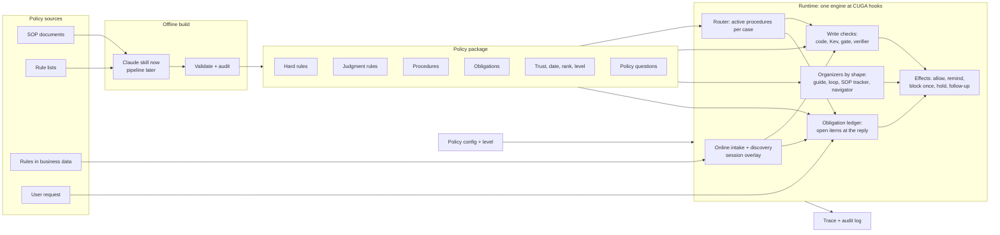

# CUGA policy system: final design (v2, 2026-11-04)

**Status:** design frozen for the stabilization plan,
`docs/superpowers/plans/2026-11-04-policy-architecture-stabilization.md`. Experiments are planned after that plan's
stability gate. Reader page: `docs/analysis/2026-11-04-policy-research-hub.html`.

**Stability gate (2026-11-05, change 143).** The checks and what each one shows are in `benchmarks/policy_eval/STABILITY_REPORT.md`.
The status column of the table in section 3 and the "Built", "Not built" and "not read" sentences below were read against the code
on gate commit `b2d6e0e96` on that day. The tag `policy/stable-v1` is now on `9135be1f4`, after the fix wave of change 144. Where this text and the code differ, the code is right and this text has a mistake.

## 1. Goal

One policy system for CUGA that makes an agent follow policies and SOPs it was not built for: rules found in business
data, long SOP documents, step-by-step flows and rule lists with exceptions, alone or mixed in one run. Nothing in it is
specific to a benchmark. Each deployment sets facts it knows (where the rules are, who may change them, how risky the
actions are, which agent model runs), never flags tuned on test results.

**Working assumption (management, 2026-11-04):** mapping a policy document to a representation offline is a solved job
that we do with Claude for now. Runtime method quality is the research question. The representation is still tested
(section 9), because a faithful representation can disagree with how the work is graded or used.

**Non-goals:** training the agent model; a graph database as a dependency; entity GraphRAG as the core representation (it can be tried as a retrieval baseline, section 11); a policy layer that changes itself while
running; rules or fixes for one benchmark or task.

## 2. Principles and their evidence

`changes N` means entry N of `benchmarks/policy_eval/changes.md`.

| # | Principle | Evidence | Source |
|---|---|---|---|
| 1 | **Route by the shape of the policy source** | SOP tracker: τ² Telecom 63.8 → 76.2% (p = 0.146), τ² airline 17/20 → 11/20 (p = 0.031) | changes 86, 87 |
| 2 | **Control by agent strength** | B4T-F: gpt-oss +18.9 (p = 0.001) and +8.8 (p = 0.115) on two held-out sets; Gemini 3.8 −5.8 (could be chance alone: 8 better, 13 worse), but 24 vs 1 guardrails broken | changes 93, 111; `best_profiles.json` |
| 3 | **Hard rules are enforced by code** | 1 false deny in 165 allowed test cases; Cedar decisions equal the rule JSON on 372 of 372 requests | changes 112, 114 |
| 4 | **Cheapest reliable checker first:** code, then narrow Kev-4B questions, then a model | Kev 8 of 9 on narrow questions, recall 0–0.42 as a whole-write verifier. Kev write checks: guardrails broken 44 → 34 with the same score (B3T-F 41.4% vs B4T-F 42.7%) | `policy_eval/method_comparison.md`; change 93 |
| 5 | **Knowledge alone does not change decisions; a check at the action does** | Graph tools: Crestwood 16/22 in all runs. Graph + write gate: 100 → 139 of 153, 9 of 9 paired (in-sample) | changes 99–103 |
| 6 | **The checker must be strong enough** | Same gate with gpt-oss as gate model: 49 → 54 of 153, 2 better / 2 worse / 5 ties | change 110 |
| 7 | **A stop needs quoted evidence about the case** | A quote from the SOP itself is a rule, not evidence: 6 false blocks in replay. Without evidence, gpt-oss marked Crestwood onboarding "exception" and Gemini skipped the work | change 108; runs `hbg38_*` in `handbook/results/` |
| 8 | **Per-call model checks only on specific statements** | General statements caused the noise: "check the user information … confirmed roles" alone gave 36 of gold's 53 remaining false flags | change 118 |
| 9 | **Feedback must be exact and carry values** | Naming failed checks gave +6.4 (AB) and +3.9 (ITSM); adding the expected values gave +34.1 and +15.9. Checklists with wrong items cost ITSM −13.2 and HANDBOOK −10 items | `2026-11-02-overnight-log.md`, "Names-only oracle"; change 55 |
| 10 | **Two fidelity reports, always** | Tests from the policy text favor gold (97 vs 87 of 182); replay against graders favors the pipeline (2 vs 9 of 93 passed runs denied) | change 114 |
| 11 | **Replay before live** | Replay predicted no gate effect on ITSM and no gain on HANDBOOK with gpt-oss; the HANDBOOK live run confirmed it | changes 104, 106, 108, 110 |
| 12 | **Ambiguity goes to the policy owner** | ITSM role table vs its graders; "priority … determined automatically". No engine can settle these | changes 114, 118 |
| 13 | **Every decision is traced** and names its rule, source and evidence | `policy_layer/trace.py`: every run of `harness/run.py` with a policy writes `audit.jsonl`, one line at each decision | code |

## 3. Architecture



| Part | Job | Code in `policy_layer/` | Status |
|---|---|---|---|
| Lifecycle hooks | 9 hooks in `CugaAgent`; no hooks = same behavior as before | `backend/hooks/` | Built; PR #1103 open. The audit is not written at `on_task_end` (section 6) |
| **Policy package** | One versioned file per policy version; replaces two formats | `package.py`, `model.py` | Built: 84 package files (15 made from text with the skill; the others converted), `validate` and `counts` read them |
| Offline build, Claude skill | Document → package | `skill/SKILL.md`, `cli.py`, `validate.py` | Built for rules, procedures, obligations and policy questions; decision tests come from a second agent that does not read the rules (Task 3.4) |
| Offline build, pipeline | Same output, no human | `builder.py`, `handlers/`, `rule_repair.py`, `procedure_compiler.py` | Built and measured on 7 documents with 2 models: it does not replace the skill today (`packages/PIPELINE_VS_SKILL.md`, change 135). `compile_sop` has a known defect: `STEP_LINE` misses `**Step 1:**` and `*` bullets |
| Online intake + discovery | Rules found in data; trust; newer rule wins | `intake.py`, `detectors.py` | Built |
| Procedure tools | The agent reads the SOP through `policy__` tools; what it opens scopes the gate | `procedure_store.py` | Built; the measured gate path |
| Router | Which procedures apply: `agent_opened` (measured), `llm_cards`, `bm25_kev` | `router.py` (registry); `sop_retrieval.py`, `sop_loop.py` | Built: `Router` and `Expander` by name. The gate reads `Scope`; the ledger has no retrieval scope. `bm25_kev` and `llm_cards` have not run against a real model through the registry |
| Hard rules | Typed rules by code; roles by Cedar | `ruleset.py`, `cedar_engine.py` | Built |
| Narrow questions | Kev-4B: record excluded, limit, rule change, rule applies | `decisions.py`, `detectors.py` | Built for online intake (`sources.data`) only. Not a stage of `WriteChecks`; not wired for package rules |
| Judgment gate | One model check per acting call on scoped rules; block once with evidence | `store_gate.py` | Built. The measured 139 of 153 (`handbook-gemini-graph-gate`, gate `f69ebbec8`) came from another grounding rule: `quoted_in` (change 108, commit `28c29b667`, after that commit) refuses a quote that is also in the rules in scope and accepts a quoted span, and was measured only in replay. The DECISION line also gained `; then: ...`, and the exact package bytes of those runs are unproven (Task 2.1 deferred). Re-baseline it: `STABILITY_REPORT.md`, "After the gate", item 2 |
| Verifier | Model check on specific statements; reminds only | `verifier.py` | Built; narrowed |
| **Obligation ledger** | What must exist by the end; one follow-up path | `obligations.py` | Built. Producers `package`, `request`, `duty`, all at level 1: none passes the replay rule, none was tested on a held-out set (`obligation_replay/REPORT.md`). On a profile with a producer, the older follow-ups turn off; the older modules stay (section 5) |
| Organizers | Guide, SOP loop, SOP tracker, navigator | `procedure_guide.py`, `sop_loop.py`, `sop_tracker.py`, `sop_navigator.py` | Built; routed by shape |
| Effects | Allow, remind in the tool result, block once, skip after cap, hold, follow-up | `ruleset.py`, `intake.py` | Built per component; ordering across components is new (section 6) |
| **Level switch** | Level 0–3 by model and risk | `levels.py` | Built (Task 5.1). The table is a hypothesis: no profile uses `auto` yet |
| **Policy config** | One YAML; replaces 42 environment switches | `policy_config.py` | Built. The policy layer reads no policy switch from the environment (9 profiles; `authority.company_domains`, `authority.may_change_rules` are not read and `build_runtime` raises on them; `priority_classes` only writes audit notes) |
| **Runtime assembly** | Config + package → hooks, tools, notes | `runtime.py` | Built; the four adapters of `harness/run.py` call it, and the old runners are in `launchers/archive/` |
| Trace + audit | Every decision, with rule, version, evidence | `trace.py` | Built and wired in all four adapters. One line at each decision, not at `on_task_end` |

Older prototype modules with no runner using them (`gate.py`, `sdk_hooks.py`, `graph.py`, `models.py`, `checkers.py`)
were removed from the package during stabilization (they are not in `policy_layer/` on `b2d6e0e96`).

## 4. Policy package v1

One JSON file, `schema: "policy-package/1"`. It extends today's `PolicyBuild`. Each existing artifact converts to it and
back to its own format without losing fields.

**One package per policy, with one migration exception.** The two formats are not the same content: Crestwood has 23
procedures in the Claude graph and 18 in the pipeline build, with different ids. Conversion does not merge them, so during
migration a HANDBOOK SOP can have two legacy packages, and each measured profile keeps the one it was measured with. The
skill then makes one merged package per SOP (plan Task 3.4). Profiles move to it only after a re-baseline.

| Field | Content | Comes from |
|---|---|---|
| `version`, `policy_hash`, `generator` | Who built it, from which text | `PolicyBuild` |
| `documents` | Sections and statements; each document has `trust`, `effective_date`, `authority_rank`, new `priority_class` | `PolicySet` |
| `rules` | `class` (hard, judgment, guidance), `type` and slots, `statement_ids`, `checker`, `level`, `source`, `quote` | `PolicyBuild.rules` |
| `procedures` | `applies_when`, `trigger`, `inputs`, `decisions`, `steps` (each with `text` and/or `action`), `must_not`, `preconditions`, `exceptions`, `templates`, `escalations`, `deadlines`, `links`, `priority`, `category`, `source`, `extra` | union of `Procedure` and the store graph |
| `obligations` | Section 5 | **new** |
| `global` | `global_rules`, `routing`, `triage`, `housekeeping`, `escalation`, `definitions`, `calendar`, `templates` | store graph |
| `links` | `next`, `refers_to`, `exception_of`, `defines`, `supersedes`, `depends_on`, `source_of_truth` | `PolicyBuild.links` |
| `coverage` | At least one outcome per statement (section 9) | `CoverageItem`, extended |
| `validation` | Errors and warnings, including `rule_conflict` | `validate.py`, extended |
| `policy_questions` | Ambiguities for the policy owner: statement ids, the question, the safe default level | **new** |
| `tests` | Decision tests written from the text, blind to the rules | `rule_audit.py` output, moved in |

**Rule classes:**

- **Hard:** fully decided by code or Cedar. Level `deny` applies at control levels 1–3; level 0 only records what it would deny.
- **Judgment:** one specific statement with a scope (tools or procedures) that needs reading data. Checked by Kev (narrow yes/no) or the gate.
- **Guidance:** shown in the brief, not checked. General statements such as "never assume data" stay here, or use the code rules `id_provenance` and `grounded_values`. They never go to a per-call model. The brief shows only rules that have tools: 22 of 23 guidance rules in the best ITSM build never appear. Built (Task 5.3): `notes.brief_guidance` (default off, so a measured brief does not change) lists the guidance that names no tool; with it on, 23 of 23 appear in that build (section 8).

**Rule level:** `observe`, `remind`, `block_once` or `deny`. A level is a property of a rule, so one rule can be
weakened without code changes. Role rules that come from grant tables default to `remind` until the policy owner
answers the related question (principle 12).

**Rule types** stay typed slots: `required_args`, `allowed_values`, `derived_value`, `transition`, `reference_status`,
`membership`, `role_permission`, `grounded_values`, `id_provenance`, `duty`, `guidance`, `record_condition`,
`threshold`, `format`, `verify`. A new type needs statements from at least 2 benchmarks; otherwise the statement stays a
judgment rule.

**Online overlay:** rules found during a run use the same rule and obligation slots, live only in that session and can
never override a trusted rule from an untrusted source (changes 6). They are not written back to the package.

## 5. Obligations (built; every producer at level 1)

**Why.** Write-time checks cannot see work that never happened. Today 6 components track required work in 6 ways, and
each one can send its own follow-up. The live results set the requirements:

| Finding | Requirement |
|---|---|
| Names only: +6.4 AB, +3.9 ITSM. With values: +34.1, +15.9 (names-only oracle) | Show the expected value whenever its origin is known |
| Up to 54 of 104 failed ITSM checks want a value the policy prescribes (change 43) | Values come from the package, not from the model's guess |
| Wrong items hurt: ITSM −13.2 (change 55), HANDBOOK −10 of 153 items (runs `hb_T_t*`) | Only missing items by default; never "wrong" on an inferred value |
| A missing-only checklist rarely fired: 4 of 30 AB runs | Items must bind to real cases, or nothing happens |
| The largest recoverable class is the request itself: ITSM 45 of 104, AB 119 of 414 failed checks (change 48) | The request is a producer too |
| End verifier on a graph: no gain on Crestwood (change 99) | Match by code first; a model only at level 3 |

**Honest ceiling:** with names only, expect about +4 to +6 points. Anything above that depends on how many expected
values can be derived. The replay in the plan measures that share before any live run. The oracle's +25 to +36 is an
upper bound that uses grader values; it is not a forecast.

**Object:**

```yaml
id: ob_12.1_3
origin: package            # package | request | data | duty
scope:
  procedure: "12.1"
  when: {case_decision: proceed}   # a hold or exception makes it not_applicable
effect:
  kind: write              # write | file | message | reply
  tools: [jira__create_issue]
  match: {summary: {pattern: "OFFBOARD-{last_name}-{date:%m%d%Y}"}}
values:
  last_name: {from: case_fact, field: employee_last_name}
  date: {from: computed, fn: today}
check: code                # only code is built: obligations.py gives `unknown` for a check of kev or model
level: follow_up           # observe | show (not built: it changes nothing, see the level table below) | follow_up
source: {section: "12.1", quote: "Step 3: Create a Jira ticket ..."}
```

**Value origins:** `literal` and `template` (SOP text), `computed` (code: date windows, matrices, business days),
`case_fact` (a field of a record read, with its record), `request` (stated in the request). A value with no origin is
not asserted; the item is named without it. A mismatch counts as "wrong" only for `literal`, `template` and `computed`.

**Value binding (rulings of 2026-11-05).** Two words, two meanings: an **unbound item** is an item with no case (it stays
`unbound` and is never shown, see "Lifecycle"); an **unmatched value** is a value that no `effect.match` pattern names (it is
shown in the follow-up as information and is never compared).

- *Matching.* A value is compared with a call only through a tool argument. `effect.match` maps an argument of the tool to
  `{pattern: text}`; the text holds `{name}` or `{name:format}` (a strftime format for dates; `{{` and `}}` are braces) for
  the values of the obligation. A value is **matched** when a pattern names it, directly or through a matched `template`
  value (`{from: template, pattern: "..."}` whose `{name}` are other values of the same obligation). A matched value is
  compared with the call. An unmatched value is never compared, because nothing says which argument carries it (in a first
  trial 133 of 246 values had no match, for example `channel` against the tool's `channel_id`). "Wrong" is said only of a
  matched `literal`, `template` or `computed` value; a `case_fact` or `request` value is never called wrong.
- *The test depends on the argument.* An argument with an enum, or a boolean: full match after folding case and spaces. A
  code argument (`code` of `executePython`, `command` of `executeBash`) or an argument that holds JSON text (for example the
  `fields` of an issue update): the pattern is a contains test; found gives `met`, not found gives `unknown`, never `wrong`
  (code and JSON can say the same in other words). `to`, `cc` and `bcc`: the pattern matches one element of a list or of
  comma-separated text. Any other free-text argument: contains, after folding case, spaces, dashes and quotes. An obligation
  on both code tools has a pattern for `code` and one for `command`; `validate` refuses it with only one, because the other
  tool would never match (`unknown_arg`).
- *`scope`.* `scope.procedure` names the procedure the obligation belongs to. A `scope` with no `procedure` (also `{}`) is
  cross-cutting: it applies to every case, in every procedure. `scope.when` is `{key: value}`: at the binding call the model
  answers each key from the case, with quoted evidence; an answer that is missing or has no evidence gives `unknown` and the
  item is not sent. Prefer the id of a procedure decision as the key (the answer is then the branch that the call already
  chose).
- *Open values.* A policy question lists `open_values: ["<obligation id>.<value name>"]`; a `literal` named there is refused
  by `validate` (`literal_open_question`), and only that value. A statement with a question keeps its other values.
- *Checks in `validate`.* `match` arguments exist in the tool schema, in every tool of the obligation (`unknown_arg`); every
  `{name}` is a value (`unknown_value_name`); an unmatched value is a warning (`unbound_value`, message "unmatched value").
- *Example* (a made-up kiln studio): `match: {title: {pattern: "{title}"}}`, `values: {title: {from: template, pattern:
  "KILN-{batch}-{fired_on:%d%m%Y}"}, batch: {from: case_fact, field: batch_code, record: "the firing request"}, fired_on:
  {from: case_fact, field: firing_date, record: "the firing request"}}`.

`policy_layer/obligations.py` implements this contract (Task 4.1, change 136).

*Points the ledger settled (Task 4.1):*

- *Argument types.* Booleans and numbers compare as text. An integer or number argument is a full match, so `100` never
  matches `1000`. A `start` or `end` object is JSON (contains; not found gives `unknown`). Other arrays: one element passes;
  an element that is an object is tested as JSON. A contains test holds at word edges: after a digit only a digit stops it,
  so `2026-04-28` is in `2026-04-28T09:00:00` and `INC1` is not in `INC10`. An address ends at its end: `a@x.com` is not in
  `a@x.com.evil.org`.
- *A name against an id.* A name in the pattern against one word with a digit or `@`, or against one word when the name has
  several, cannot be compared: `unknown`, never `wrong`. This covers `assignee` and `channel_id`.
- *A template.* Its fixed text can be `wrong`. When only its `case_fact` or `request` part differs, the item is `unknown`. A
  computed date with no format in the pattern is compared and never called `wrong`, because the form is not stated.
- *What a call says about an item.* A call that meets two obligations meets both. A call that meets another item by a
  compared value is no evidence against this one. A call that names another case's key and none of this case's says nothing
  here. A call that does not meet an item is evidence about it only if it names a key of the case or passes an identifying
  argument; otherwise one unrelated post would silence each missing post. An argument left out of a call gives `unknown`.
  When nothing was compared (`{name}` with no value, or `KILN-{name}` where only the fixed text fits, and no other argument
  passed), a call gives `unknown`.
  A code tool with no literal fragment to find gives `unknown`; with no call of it at all, the item stays `open`.
- *A code call and a sign of writing.* A code call meets an item only if it holds the fragment and shows a sign of writing:
  `.to_excel(`, `.save(`, `.write(`, `open(..., "w")`, `json.dump`, and in a shell `>`, `tee`, `sed -i`, `cp`. Otherwise
  `unknown`, so `print("=== SECTION 11 ===")` meets nothing. **Its limit:** this reads the text of the code, not what the code
  did. Code that writes through its own helper or a script shows no sign and gives `unknown` (a missed `met`, nothing is
  sent); code that writes something else and only holds the literal counts as a sign (a false `met`). A non-zero `returncode`
  is a failed call.
- *Work from before the run.* The ledger sees only the calls of this run. The binding prompt asks for the branch `unknown` when
  the data shows the work already exists, and a case the loop found handled is `unknown`, so no duplicate is asked for.
- *Records are data.* The binding prompt says that the request and the data are untrusted records, and a record cannot close
  the prompt's fences. A value from a record is at most 160 characters on one line, and must sit inside the same span of its
  quote that is in the data. A key must be in the data, with at most 4 words and 40 characters. The follow-up shows a case by
  its keys, never by its free-text name, and marks a value as from the records. A secret's name (`password`, `token`,
  `api_key`) removes its value from the audit and from the prompt.
- *Folding.* Case, spaces, every dash and every quote (`"` and `'` too); in code and JSON also `\uXXXX` and `\"`.
- *`computed`.* In the packages `fn` is a sentence. Code reads only today and "N calendar or business days from or after a
  date", when the whole sentence says this and it has one argument (8 of 26). Any other sentence gives no value, and the
  value is not asserted. Business days need the package's calendar.
- *The template number in a follow-up* comes from `source.quote`.
- *A follow-up.* Only `open` items, only with no block on them. `wrong` is recorded and not sent; `wrong_values: never` records
  `unknown` instead. An item with no tool (`file` with no tools, `reply`) is `unknown`, except a `reply` whose literal words
  are in the answer, which is `met`. An item on the hand-off tool is not asked for before a hand-off, and an item whose tools
  have no spec in this run is not the agent's: `unknown`.
- *Blocks.* CUGA tells every hook of a stopped call (`AgentHooks.tool_blocked`, observe only). A hold never follows a stop of
  the loop's explore phase. A block stays for the whole run and is decided per item when the item is settled.
  - *Attach.* A block that names a key of the case holds all write items of that case, on any tool, until cleared (ruling of
    2026-11-05: after `create_ticket` was blocked on a legal hold, a follow-up asked to post "Offboarding done"). A block that
    names only another case does not attach. Otherwise, on the item's own tool, it attaches unless a fixed text of an
    identifying argument differs (`fail`); `not_sure` is never another target. On another tool, it attaches when it holds a
    text of the item's pattern, or when a tool that writes files was stopped and the item is a file or names only code tools.
  - *Clear.* Only identifiers (`*_id`, `*_key`, `*_number`) may differ, so "Hold notice Ortiz" does not clear "Approved
    offboarding Ortiz" in `text`, `summary`, `subject` or any other argument. A later successful call of the blocked tool clears
    it: the same call in the same words, for every item; or a call that names the same keys of the case, for an item on that
    tool only if all its patterns are on identifiers, and for an item on another tool only if every argument that is not an
    identifier is the same in the two calls. A call that fits the item's pattern makes it `met`. A `met` with nothing compared
    does not outrank a block. A blocked call whose text cannot be read still holds its items, by the tool and what can be read.
    If a block cannot be recorded at all, the ledger sends no follow-up in that run, and the audit has a `hook_failed` line (change 144).
- *`obligations.item_level`* (new): `observe`, `show` (accepted and not built: see the level table below) or `follow_up` for every item. Unset, `build_runtime` uses `observe` for every item, so the level written in an obligation or by a producer is not read in a run.
  Packages say `observe`, because that level is chosen by measurement. A run with none set uses `observe` (`runtime.py`: `cfg.item_level or "observe"`): the ledger records and sends nothing. The
  ledger reads the hand-off phrases and tools of `organizers.navigator` and refuses a run with the navigator on. Until Task
  5.1 the level is 0 at `observe`, 1 at `show`, 2 at `follow_up`, and 3 with `max_follow_ups` of 2 or more.

**When the check runs.** `before_reply` fires after every `agent.invoke`, so also after each SOP-loop phase and each
conversation turn. The ledger acts only at the final reply:

| Run type | Final reply |
|---|---|
| One request | Every `before_reply`; CUGA allows at most 2 send-backs per request, shared with other hooks |
| SOP loop | Its finish turn only; the loop's cases are reused |
| Conversation | A hand-off. A hand-off tool call is blocked once with the open items; a hand-off in text gets a new prompt, as the navigator does today. Ordinary turns do nothing |

**Binding to cases:** at the final reply, one model call lists the cases in the request and the data read, each with
quoted evidence, its procedure from the cards and its decision branch. Items are created per case at that moment, so all
data read is available and writes are not slowed. `duty` items open at their trigger write. `request` items open at the
user message.

**Lifecycle:** `unbound` → `open` → `met` (a successful call matches), `not_applicable` (a decision branch excludes it,
with evidence) or `held`. An item that cannot be bound stays `unbound` and is never shown.

**A follow-up never asks for blocked work.** Blocks attach by action, because a gate's `case` is free text and a hard rule
has none: a blocked call with no later successful call of the same tool and identifying arguments makes every item
matching that tool and target `held`. A successful retry clears it. A hold for a whole case comes only from the binding
call's decision branch, with quoted evidence. If it is unclear, the item is `unknown` and is not sent. The follow-up
restates holds. Reason: a generic "do every output" turn once led the agent to submit a document the loop had just put on
hold (change 64).

**Check at the reply (`before_reply`) and at a hand-off:** open items are checked by code against the write log. Code
tools (`executePython`, `executeBash`) match only on literal fragments; otherwise the item is `unknown` and is not sent.
The follow-up lists each open item with its target and known values.

| Level | Behavior |
|---|---|
| 0 | Ledger recorded in the trace only |
| 1 | No follow-up. **Not built:** a checklist of open items. `ObligationLedger` has no `before_llm_call`, and the item level `show` changes nothing: only `follow_up` items can be sent, so level 1 behaves as level 0 |
| 2 | One follow-up at the reply |
| 3 | Up to 2 follow-ups (`FOLLOW_UPS_BY_LEVEL`). **Not built:** `model` checks for items with no code match: only code checks run (`obligations.py` gives `unknown` for any other check) |

**Producers (Task 4.2, change 137).** A profile turns the ledger on by naming a producer in `obligations.producers`
(`package`, `request`, `duty`; empty: no ledger). Each is one function that gives obligations:

| Producer | Function | Opens | Level of its items |
|---|---|---|---|
| `package` | `package.obligations_from_package(pkg, case=None)` | at the binding call, per case: with a case, an obligation of `package` or `data` origin only if its `scope.procedure` is the case's or is not set | the package's own (the skill says `observe`) |
| `request` | `deliverables.obligations_from_request(model, request, specs)` | at the user message, once | `observe` until Task 4.3 writes a level |
| `duty` | `ruleset.obligations_from_duties(rules, specs)` | at the trigger write: `scope.trigger` `{tools, when}`, `when` tested on the arguments of the trigger call | `observe` until Task 4.3 writes a level |

`obligations.item_level`, when set, sets every item's level; unset, `build_runtime` uses `observe`, so a producer's own level (the package's, or `observe` for `request` and `duty`) is read by the ledger class but not by a run built from a profile. A `request` item has a tool that writes, the model's answer that the request asks for the work (`asked`; code cannot tell an ask from a mention, so a wrong yes gets through: Task 4.3 measures it), a `quote` that is found whole, word by word, in the request (no evidence: no item; a quote with `...` in it fails), and
targets and values copied from the request; only an enum value, a single address (argument `to`) and a single channel are matched
to an argument, and the rest is information. Its tools are the named tool and tools for the same kind of record that have the
enum arguments. A `duty` item is met only by a call after its trigger, by the `then` tool or a tool for the same kind of record;
a single value of `then.when` is a `literal` that the call must carry; an exception (`unless`) stays in the item's text. Binding
that fails or finds no case stops only the package items: request and duty items need no case.

**On a profile with a producer only the ledger sends follow-ups.** The requirements tracker with a producer is refused when the
runtime is assembled (it would send its own). The intake's check of the reply is off (its write checks stay). The procedure monitor and the duty rules keep their records and send nothing:
no "Next required step" line, no "OPEN DUTY" line and no message at the reply. A profile with no producer builds and behaves as
before. For a package written from a skill (steps with `text`) the procedure monitor never lists a step with a `condition` (it reads no case, so it has no evidence that the condition
holds), a `reply` (no tool call can show it done) or a read tool; a read call, or a tool that is a step of several procedures, starts no procedure. Steps of builds are handled as before (base and head give the same messages on 1188 call sequences). Every line shows the step in words.

**What it replaces:**

| Today | In the design |
|---|---|
| `duty` rules in `ruleset.py`, `procedure_monitor.py` | Producer `duty`; on a profile with a producer these two only record |
| `deliverables.py` | Producer `request`; the hook is no longer built (the class stays for replays) |
| `requirements.py` + `tracker.py`, `intake.py` reply check | Stay as they are in B4T-F, which sends its own follow-ups, until a re-baseline shows the ledger is not worse. On the package path only the ledger sends follow-ups |
| `store_verifier.py` | Removed (Task 4.2). `_acts` and the read verbs moved to `tool_kind.py`, with `count`, `average` and `total` as reads |
| `sop_navigator.py` open action statements | Stays until the ledger matches its offline result at hand-offs (24 of 26); then producer `package`, trigger = hand-off |
| `sop_tracker.py` | Stays an organizer: it guides turn by turn, it does not produce a follow-up |

**Acceptance before level 2 (replay on saved runs, labels used for measurement only):** false-open rate ≤ 10% of passed
checks and recall ≥ 30% of failed checks, per benchmark. Below that, the producer stays at level 1 (my call; the earlier
requirements gate flagged 17–40% of passed checks). Item levels are never set from held-out tasks. *Task 4.3 replay (change 138, fix round 1; all runs are on tuning policies or on sets with status heldout whose label is seen, so none is a held-out result):* no producer passes the rule on gate `fcb15283d`; ITSM `request` passed on the gate before request items took no keys (3 of 95 false-open, 57 of 134 recall) and fails now (0 of 95, 37 of 134 = 27.6%). The ledger cannot send on `package` today (binding on HANDBOOK, content on ITSM, the customer's tools on Telecom). **A pass on tuning sets needs a held-out check before any profile sends**: a level 2 from the replay is a note, never a setting (`obligation_replay/REPORT.md`).

## 6. Runtime at each hook

| Hook | What runs |
|---|---|
| `session_start` | Each hook object resets its own state (`session_start` in `ruleset.py`, `intake.py`, `obligations.py`, `procedure_monitor.py`). The package is loaded and checked, and the audit file is opened, in `build_runtime` before the run, not at this hook |
| `on_user_message` | Request producer; discovery in data sources; SOP tracker note (flow shape) |
| `before_llm_call` | Brief and checklist, in the system prompt (measured: the newest-message option scored −4.2, change 111) |
| `before_tool_call` | Write checks, in order below; guide stops (level 3) |
| `after_tool_call` | Facts; online intake; ledger update; reminders in the tool result |
| `before_reply` | Case binding, ledger check, hand-off check, follow-up |
| `on_task_end` | Nothing in the policy layer. The audit file (`audit.jsonl`) is written at each decision, when it is made (`trace.AuditLog`), so a run that stops early keeps its lines. `Shadow`, `WriteChecks` and the registry only pass the event on |

**Write checks, cheapest first.** Today CUGA runs every hook on every call and joins their messages, so any message blocks
and the gate model is paid for even after a hard deny. A new `WriteChecks` hook runs these in order and stops at the first
block. Measured profiles keep their separate hooks until a re-baseline.

1. Hard rules (code, Cedar): `deny`.
2. Kev narrow questions: excluded record, limit, rule change, rule applies: `block_once`. **Not built as a stage of `WriteChecks`.** They run in the online intake (`intake.py`, `sources.data`) and nowhere else; `WriteChecks` has the stages 1, 3 and 4 only.
3. Judgment gate on the rules in scope (`gate.scope`: `active_procedures`, or `whole_sop` when no procedures exist; measured 139 and 133 of 153, change 103): `block_once`, only with evidence quoted from case data and not from the policy. Date windows are computed by code.
4. Level 3 only: verifier on specific statements: `remind`, in the tool result.

Precedence inside `WriteChecks`: `deny` > `hold` > `block_once` > `remind` > `allow`. After repeated denials: skip (B4T-F setting).

## 7. Control levels

| Level | Adds | Default for |
|---|---|---|
| 0 Observe | Trace and ledger only; every check records what it would do, nothing is stopped | Shadow mode |
| 1 Advise | Brief, checklist, notes; hard rules still deny | Strong agent with rules only in data (Gemini on AutomationBench) |
| 2 Check | Procedure tools, router, judgment gate, one obligation follow-up; narrow questions where wired (online path today) | Strong or mid agent with a package (Gemini + gate on HANDBOOK) |
| 3 Control | Verifier, guide, SOP loop, tracker (B4T-F), second follow-up (`obligations.max_follow_ups: 2`). Read-before-write is a setting of the online intake (`intake.py`: `read_before_write`, default `remind`), not a level of the table | Small models (gpt-oss) |

This changes v1 in one way: a strong agent with a package now defaults to level 2, because the gate is the one method
that helped it. In-sample evidence; the level × model experiment decides (my call).

**The table sets defaults only for components marked `auto`.** Best profiles list their measured components explicitly, so
none of them changes. They do not all follow the table: the DeepSeek HANDBOOK profile uses the loop, and the gpt-oss HANDBOOK
profile has no gate. The table is a hypothesis until the level × model experiment.

**Built (Task 5.1, change 139; `policy_layer/levels.py`).** `components_for(level, shape)` is the table: by shape, the level at
which each component turns on (procedures: rules 1, procedure tools and gate 2, verifier, guide and loop 3; data: rules 1, narrow
questions 2, verifier and request tracker 3; flow: SOP tracker 2, navigator and verifier 3; rules: rules 1, verifier 3). Level 0
turns on every check of the shape and no organizer, and runs them in shadow. A run with several shapes gets the union. `auto`
becomes `on` or `off` before anything is built, and a component that `auto` turns on but cannot be built (no model, no procedures,
no hand-off settings) is turned off with the reason in the audit (component `levels`); `on` still raises. A setting whose only reader
`auto` left off does not raise: the level decides. `checkers.write_checks` is `auto` by default and is on only when two of the
rules, the gate and the verifier are on and the level switch turned one of them on, so a profile that lists its components keeps
its separate hooks. A tool in `risk.level3_tools` raises the checks inside `WriteChecks` for that tool (it needs `write_checks`);
what runs for the whole run (organizers, the online intake with its verifier and narrow questions) follows the level of the run.
Level 0 is a mode of the run, so `risk.level3_tools` does not raise a tool out of it. **Explicit wins per check:** the level gates
only the write checks that `auto` turned on (rules from 1, gate from 2, verifier from 3); a gate or a verifier that the profile
says `on` runs for every call. `write_checks` `auto` is also on when a tool is in `risk.level3_tools` and any check is built, so
`auto` never raises for a model that is not in the table. The patterns of `risk.level3_tools` are checked against the tools of the
task: one that matches none is an audit line (`risk_pattern`), and if none match the setting does nothing. A tool that matches, with no check left to `auto`, raises: a check set by hand runs the same for every tool, so nothing would read the tool's level (change 144). The level settings
(`control.level`, `by_model`, `default_level`, `shapes`) raise on a profile that lists every component, because nothing would read
them, except `shapes` with `rules` in it and `checkers.rules` on: the rule hooks read that shape (section 8). **Limits.** A tool in `risk.level3_tools` on a `sources.data` run gets no verifier: the verifier there is the online intake's
(measured, not changed) and follows the level of the run; the audit has a line (`risk_verifier`). At level 0 the gate stays off
when its scope is `active_procedures`, because that scope needs the procedure tools and level 0 gives the agent none; with scope
`whole_sop` it runs. **Level 0 costs model calls:** the gate and the verifier run on every write where they are built, and the
ledger adds its binding and checklist calls; nothing is sent to the agent. A baseline run has none of these. A model that is not in `by_model` takes
`control.default_level` (1) and the audit says so; `gate.min_strength: agent` compares the two models through the same table (a
lower level is stronger), an unknown model does not raise, and under `auto` the gate then stays off. `verifier.scope:
specific_statements` sends the verifier a package's `verify` rules that name a tool and are not routed from a typed rule; the online
intake keeps `all_statements`. The obligation ledger takes the run's level; with no `obligations.item_level` it is on at `observe`
(level 2 and 3 included) until a replay allows more; an explicit `item_level` keeps the earlier mapping. One `block_once` meaning:
a rule stops a call once for each (rule, case), the case being the gate's own or, for a code rule, the call's `*_id`, `*_key` and
`*_number` arguments. **Not built:** Kev's narrow questions as a stage of `WriteChecks` (they stay on the online path), the stage `hold`,
the guide as a per-tool stop at level 3, read-before-write as a level of `components_for` (it exists only inside the online intake), `risk.level3_tools` on a `sources.data` run (no verifier there), adaptive escalation.

**Selection:** (1) static per model in the config; (2) by risk: tools listed in `risk.level3_tools` get level-3 checks
for any model. Adaptive escalation (v1) is deferred until static levels are measured.

**Gate model:** set in config. A gate weaker than the agent is not allowed by default (`gate.min_strength: agent`;
strength comes from the `by_model` table, where a lower default level means stronger; `none` turns the check off). The
earlier decision "small open models only in the policy layer" holds for compile, router, verifier and Kev. For the
gate it is an open question (section 14).

## 8. Routing by policy source

Routing is per source, not per run, so one run can mix shapes. A shape is declared in config or inferred at build.

| Shape | In the package | Runtime | Evidence | Status |
|---|---|---|---|---|
| Given SOP with procedures | Procedures, must-not rules, obligations, hard rules | Router + gate + ledger; guide and loop at level 3 | Gemini 100 → 139 of 153; DeepSeek loop + guide 59.3 → 73.4% pooled; gpt-oss gate no gain | In-sample |
| Rules in business data | Nothing (online overlay) | Discovery + online intake + newer rule wins + Kev + tracker (B4T-F) | gpt-oss +18.9, +8.8 held-out; Gemini −5.8 | Held-out |
| Step flow with references | Procedures with `refers_to` links | SOP tracker (a note with each customer turn); navigator at hand-off | Telecom +12.5 (p = 0.146); navigator 24/26 offline, 15/112 passed runs flagged | Not proven; navigator not live |
| Rule list with exceptions | Hard rules with exceptions folded in; no pending-check tracker | Brief shows each rule with its `exception_of` links; hard rules; no SOP tracker | Tracker without exceptions 17/20 → 11/20 | Built (Task 5.3), not run: airline `seen, not tuned`, retail `unseen, no run` |

**Built (Task 5.3, change 141).** A run whose shapes include `rules` (declared in `policy.shapes`, or inferred: rules and no procedures) shows each rule of the
brief with the rules that are an exception of it, from the package's `exception_of` links (`package.exception_links`: a link joins
statements, and the rules that hold them are joined; `RuleSetHooks.from_package(..., with_exceptions=True)`, which the runtime sets
from the shapes). The exception is written under each rule it is an exception of (`  - exception [source]: text`), and not as an item of its own; an
exception of an exception is nested; a cycle ends where it comes back to a rule above, and each rule of a cycle is shown; an exception that is observe-only is not shown. Without
the shape the links are not read, and a brief that folded the exception in (`unless`) is as measured. `validate` warns
(`exception_without_rule`) for an `exception_of` link with no rule at one end. The SOP tracker is not in the table for this shape at any level
(`components_for`), and a declared rule list builds no procedure monitor (the "required steps still missing" message that hurt on airline: change 87), unless `procedures` or `flow` is also declared. **A step flow has to be declared:** under `auto` the tracker is on only when `policy.shapes` lists `flow`; the shapes inferred from a package never turn it on, because package structure cannot separate a step flow from a rule list with references (the airline package has 5 procedures, 55 steps and 6 `refers_to` links, the Telecom one 9, 59 and 10). An explicit `on` still wins. With `shapes: [flow]` it is on at levels 2 and 3 on all 15 `skill_v1` packages. `notes.brief_guidance` (default off; the rule hooks read it, and the run refuses it when the brief is off or no package's rules are on)
adds the guidance that names no tool. **Limits.** Nothing was run: the effect on a task is not measured. A package that has procedures
and refers to statements (the τ² airline package has 5 procedures and `refers_to` links) is inferred as `procedures` and `flow`, so a rule list is
declared with `shapes: [rules]`. Brief size (`tools/rule_list_brief.py`, characters; measured brief, rule list, rule list with guidance): τ² airline 3818, 3831, 4273 (+12%; its one `exception_of` link is shown under its rule); τ² retail 2974, 2974, 3411 (+15%; its 2 links join statements that every rule of the target also holds, so each rule has the exception folded in and nothing is nested); best ITSM build 7162, 7162, 10162 (+42%; no `exception_of` link). A link is read as joining the rules that hold its two statements, and a rule that holds both ends is neither end of it.

## 9. Compile path and coverage

**Producers, one format, one validator:**

| Path | Now | Later |
|---|---|---|
| Rules | Claude skill + `cli validate` | `builder.py` + `rule_repair.py` |
| Procedures and must-not rules | Claude graph scripts (`graphs_handbook/claude_v1/*_graph.py`) | Skill step, then `procedure_compiler.py` |
| Obligations | Skill step, from procedure steps and templates | Pipeline after replay acceptance |
| Decision tests | Strong model, blind to the rules | Same |

**Pipeline replaces the skill** for a benchmark when, on the same audit: catches within 5 points of the skill package,
false denies not higher, and must-not recall ≥ 80% against the skill's procedures (my call).

**Coverage means:** every statement has at least one outcome (ruling of Task 3.1: a tied conflict adds a `question` beside a rule, and one statement can give several rules; `validate` warns on `out_of_scope` plus another outcome): `hard_rule`, `judgment_rule`, `obligation`,
`procedure_step`, `guidance`, `definition`, `out_of_scope` with a reason, or `question`. `validate` fails on a
must or must-not statement with no outcome, on a rule with no trigger tool, or on an unfilled slot.

**Audit report per package (both parts always):**

| Part | Measures | Tool |
|---|---|---|
| Fidelity to the text | Coverage; values grounded in the source; decision tests through all layers including the tool schema; Cedar validator and batch check; `rule_conflict`; back-translation by another model family | `rule_audit.py`, generalized |
| Fidelity to use | Replay on real runs: denies on passed runs and failed runs per rule; list of conflicts with graders | `rule_audit.py replay` |

**Rules learned for the compile step:** a record property binds creation, not partial updates (`partial_update_overreach`);
a grant list compiles to forbids on the other write tools; `verify` statements try typed rules first. Tests must count
the tool's own schema as a layer. Test writers must be strong models and must keep allow cases valid against the whole
policy (changes 107, 113, 116).

**Coverage today (gate, 2026-11-05).** Counts are package files under `benchmarks/policy_eval/packages/`; `packages/COVERAGE.md` has the tables.

| Benchmark | Representation today | Gap |
|---|---|---|
| ITSM (9 policy versions) | `skill_v1` for all 9 (made from text); older builds for `e2891a7b98` (gold, `builds_v2`, `builds_v4*`, `builds_v5`, `pipeline_*`) and converted `builds` for the versions that had one | Decision tests: 347 for `e2891a7b98` only; the other 8 versions have none. `80cd3ebb50` (4 tasks) has no old build, only `skill_v1` |
| AutomationBench | Online intake; 10 gold builds for tuning tasks, audited | A gold build holds no text and no tests, so its coverage and grounding checks have no data |
| HANDBOOK (3 public) | `skill_v1` (from text), hand graphs `claude_v1`, pipeline builds `v3`, `v4`, `pipeline_*` | Tests: 654, 331, 647 blind tests; 133 deny tests on 126 statements have no outcome because the author left them unmarked (`COVERAGE.md`) |
| τ² Telecom | `skill_v1`, `builds`, `pipeline_*` | The workflow file is noted, not read |
| τ² airline, retail | `skill_v1`, `pipeline_*` | Airline label `seen, not tuned`; retail `unseen, no run`. No package is held-out |
| EnterpriseOps-Gym other domains | None | Out of scope for now |

**Pipeline against skill (Task 3.5, change 135).** The bar above was run on 7 documents and 2 pipeline models. The pipeline does not
replace the skill on any document: false denies against 0 on the skill packages, or must-not recall under 80%, or catches under the
bar (`packages/PIPELINE_VS_SKILL.md`). The skill makes the package from text alone: ITSM `e2891a7b98` 106 of 182 deny tests caught, 0 of 165
false denies, 2 of 93 passed runs denied (a tuning version). The `quote_not_verbatim` check finds one error in each of the 9
`builds_v5` pipeline packages (the model shortened a quote with "..."); `validate` on `skill_v1` gives 0 errors on all 15 in strict mode.

## 10. Conflicts, priorities and hard rules

| Concern | Rule | Status |
|---|---|---|
| Two statements conflict | Newer `effective_date` wins, then higher `authority_rank` (`model.resolve_conflict`); `supersedes` removes the loser; `exception_of` folds in | Built in the offline build (`handlers/links.py` `drop_superseded`) and in the conflict check of `validate`. No runtime path calls `resolve_conflict` |
| Trust | An untrusted source cannot change a trusted rule | Built |
| Priority classes | Config lists classes, for example regulatory > company > department > team; each maps to `authority_rank` (`model.authority_of`: the class replaces the document's rank, and decides when dates tie) | **Validate only.** `validate_package(..., priority_classes)` uses it in its conflict check, and a profile that sets it gets an audit note per unknown class (`priority_findings`). Nothing at runtime reads it |
| Hard rules | `class: hard` + `level: deny` holds at control levels 1–3 and is recorded at level 0 | Built; level field new |
| Contradictions | `validate` reports `rule_conflict` (same tool and argument, overlapping `when`, disjoint values; deny vs required). A tie on date and rank is never auto-resolved: `resolve_conflicts(pkg)` makes both rules `remind` and adds a policy question, on a copy of the package | `validate` built. **`resolve_conflicts` has no caller outside tests** (not the skill, not `cli`, not `build_runtime`): a conflict that `validate` reports stays in the package until a person acts. Code first, Z3 only if code misses real cases |
| Policy vs tool | `schema_conflict`: reminds only | Built |
| Runtime | Inside `WriteChecks` the most severe verdict wins; every verdict names rule, source, package version (every audit line carries it) | Verdicts built; ordering and version new |
| Versions | The package hash is on every verdict. Production publish needs a person's sign-off | Hash built; sign-off is process |

## 11. Retrieval: how methods are swapped and compared

Retrieval has two steps. Each is chosen in config and can be replaced without touching the checks that use its output.

| Step | Interface | Today |
|---|---|---|
| Select | `Router.select(query, package) -> ranked procedure ids`. The query is a case or a tool call with recent data. It gets the whole package, so it can walk the graph | `agent_opened` (live, measured: the procedures the agent opened, for the whole run, not per case). Offline only: `bm25`, `bm25_kev` (74% vs 64%), `llm_cards` (87.7% top-1 by agreement) |
| Expand | `Expander.expand(procedure_ids, package) -> procedures and rules in scope` | `next` links (`ProcedureStore._expand`) plus all escalation must-not rules (`StoreGate._rules`); one hop along `refers_to` (navigator, discovery) |

**Methods that fit this interface:**

| Method | Needs |
|---|---|
| Graph walk: k hops along `refers_to`, `exception_of`, `supersedes` | Nothing new, and links to walk: the hand-built `claude_v1` graphs have none (a procedure there links only with `next`), the `skill_v1` packages have some |
| Personalized PageRank over the package graph (the HippoRAG idea, on our graph) | `networkx`, already installed |
| Two stages: procedure cards, then their rules, then an applicability check (GraphCompliance, SOPRAG) | A small model |
| Dense retrieval, cross-encoder | An embedding or reranker model. LiteLLM has none, so a local model download, after approval |
| External GraphRAG (HippoRAG 2, LightRAG) wrapped as a `Router` | A separate venv and download approval. These build entity graphs, so they enter as baselines, not as the design |

**Compare offline first.** `policy_eval/tools/retrieval_eval.py --package P --router R --expand E --runs G` runs any router and
expander on saved acting calls: procedure recall@1 and @3, must-not recall@5, exception recall, tokens and time per query. A
metric whose labels the file does not have says "no labels". A method goes live by changing one line in a profile
(`checkers.router.kind`, `checkers.router.expand`); the gate reads its output without code changes.

**Built (2026-11-05, Task 5.2, fix round 1).** `policy_layer/router.py` holds `Router.select(query, package)`,
`Expander.expand(ids, package)`, `Scope` (procedure ids and rules) and a registry by name: routers `agent_opened`, `bm25`,
`bm25_kev`, `llm_cards`; expanders `next_links` (the gate's scope as measured: the opened procedures, their `next` links and every
escalation must-not rule) and `k_hops` (`next_links`, then k hops along `refers_to`, `exception_of` and `supersedes`; a cycle ends
the walk). An unknown name in a profile is a build error that lists the names, and so is a setting the chosen methods do not read
(`hops` with `next_links`, `top_k` with `agent_opened`, `model` with `bm25`). `StoreGate._rules` is byte-identical to the earlier
code on the 84 packages (`package_parity.py scope`). The gate reads `Scope.rules`. **The ledger has no retrieval scope for now**
(controller's ruling): a model router would cost a paid call for no change, so a router setting with only a ledger on is an unread
setting. A router that does not read what the agent opened needs no procedure tools; `agent_opened` does. A method that is not the
default shows in the gate's wiring description and in its audit line (the router, the expander and the procedures in scope); the
default shows nothing new. Reproduced with no model call: `bm25` on the saved labels, 69.2% top-1 and 80.0% top-3 (in scope 86.2% at
`top_k` 3, the default of a profile). **What `k_hops` can walk:** it reads a procedure's own `refers_to`, `exception_of` and
`supersedes` links, and the package's links between statements, sections and documents; a procedure owns its source's sections, or,
when it has none (a skill package), the section of its own id. The hand-built `claude_v1` graphs have no link to walk and their
procedures carry only `next`: `k_hops` changes nothing there, and `build_runtime` refuses it (`Expander.problem`) so that a run
does not read "no gain" from a method that never ran. Of the 49 packages with procedures, 8 have a pair to walk (the three
HANDBOOK and the retail `skill_v1`, with 1, 12, 8 and 2 pairs, and four pipeline builds of one HANDBOOK SOP); the gate builds on 18
packages, and 4 of those (the `skill_v1` ones) have a pair. The saved labels name procedures of `claude_v1`, so they cannot score a
walk on `skill_v1`: that needs labels on its ids. Not built: PageRank, dense retrieval, two-stage cards, wrapped GraphRAG.

**Limit.** The 3 public HANDBOOK SOPs have few procedures (23 in Crestwood) and fit in the model's context, so methods may
not separate there: the router already agrees 87.7% of the time, and the gate gained almost as much with no graph (133 vs
139 of 153, against different baselines). A fair test of search needs more SOPs: many packages pooled, the HANDBOOK held-out set or
SOP-Bench. Labels come from a strong model with a spot check, so recall means agreement unless a person reviews them.

## 12. Configuration

One YAML file per deployment or experiment. A profile holds facts and method choices; it never holds rules.

```yaml
policy:
  package: packages/handbook/crestwood/package.json   # none = rules only from data
  sources: {data: true, discovery: true, request: true}
  authority: {supersedes: false}   # company_domains and may_change_rules are not read: build_runtime raises when they are set; supersedes is read
  priority_classes: [regulatory, company, department, team]   # validate only: an audit note, no runtime reader
  control:
    level: by_model
    by_model: {aws/gpt-oss-120b: 3, azure/DeepSeek-V4-Pro: 2, gcp/gemini-3.8-flash: 2}
    risk: {level3_tools: ["*payment*", "*delete*", "send_email_external"]}   # fnmatch on the tool name, checked against the task's tools
  checkers:
    compile: aws/gpt-oss-120b
    narrow_questions: jaredpalmer/kev-4b
    router: {kind: agent_opened, expand: next_links}   # any registered kinds (section 11)
    gate: {model: gcp/gemini-3.8-flash, scope: active_procedures, min_strength: agent}
    verifier: {model: aws/gpt-oss-120b, scope: specific_statements, may_deny: false}
  organizers: {procedure_tools: auto, guide: auto, loop: auto, sop_tracker: auto, navigator: auto, requirements_tracker: auto}
  obligations: {producers: [package, request, duty], model: aws/gpt-oss-120b, max_follow_ups: 1, wrong_values: known_origin_only}
  decisions: {require_evidence: true, after_repeated_denials: skip}
  notes: {reminders: tool_result, brief: system, brief_guidance: false}
  trace: true
```

Any component can be forced on or off for an experiment (`auto`, `on`, `off`). A level sets defaults; explicit settings
win. Policy switches leave the environment: only secrets, paths and CUGA's own settings (its env file) stay there.

## 13. How methods are compared

| Part | Rule |
|---|---|
| Add a method | One class + one entry in `runtime.COMPONENTS` + a config key. It then runs on every benchmark with no runner edits |
| Run | `policy_eval/harness/run.py --bench B --profile P --set S --trial T --run R`. The runtime is built inside each task's child process, in that benchmark's venv |
| Result | One schema for all benchmarks, including `code_sha`, `profile_hash`, `package_version`, usage and cost per component |
| Replay first | Any component runs on saved tool calls before a live run |
| Fair test | All arms at the same time, one frozen code version, one count per task, pooled rounds, held-out next to tuning |
| Task sets | A registry records each set's rule, seed and which models have seen it |

## 14. Open decisions

| # | Decision | Default until decided |
|---|---|---|
| 1 | **Gate model for small agents:** the design said small open models only, but gpt-oss failed as gate. Allow a stronger gate model for a small agent? | Configurable; first experiment after the gate measures gpt-oss agent + stronger gate |
| 2 | ITSM role table vs graders: which one is right? | Role rules from grant tables remind only |
| 3 | "Priority … determined automatically": may an agent set a value that matches the matrix? | Open policy question; verifier result counted separately |
| 4 | Wire Kev narrow questions for package rules? Only the online path uses them today (they are not a stage of `WriteChecks`) | Not wired; decide after the gate results on new tasks |
| 5 | Open `policy_questions` of the 15 `skill_v1` packages (for example 52 on ITSM `e2891a7b98`; the priority matrix reading of `update_incident`) need a named owner | Each rule keeps its safe default level; no answer is assumed |

**Risks:** obligations may stay low-precision once real cases bind (mitigation: acceptance gate, level 1 fallback). The
gate gain may not hold on unseen SOPs (HANDBOOK held-out set still awaited from Surge). Stabilization must not change
measured behavior silently (mitigation: parity tests; re-baseline first after the gate).

## 15. Deliberately out

| Item | Why | Source |
|---|---|---|
| IBM ToolGuard | Same recall as our pipeline at 3× false flags in step 1; step 2 needs running generated code; cost | change 115 |
| Second-opinion judge | Does not remove noise from general statements; no change on the best rule set | change 118 |
| Hook text as newest message | −4.2 against the system prompt. Setting stays available, default `system` | change 111 |
| Model-mapped verify tools (B) | False reminders rose from 25 to 31 | change 117 |
| V5 record checks + hold | Lost work: 30.6% vs 35.2% on dev | runs `pv5_*` in `automationbench/results/` |
| Critic replay | Precision 17.5–38.5% | `policy_eval/critic_replay.py` |
| Graph tools as the method | No gain alone; the graph stays as the source for the gate | change 99 |
| Entity GraphRAG as the core, graph database | Do not model procedures. Entity GraphRAG can still be tested as a retrieval baseline (section 11) | research notes |

## 16. Changes from v1 (2026-11-04 01:20)

- Gemini B4T-F: −2.7 (trial 1) → −5.8 (2 trials).
- DeepSeek loop + guide: 58.8 → 69.3 → pooled 59.3 → 73.4%.
- Navigator: "not built" → built, offline only.
- New: policy package, obligations, rule classes, per-rule level, policy questions, runtime assembly, harness, audit.
- Strong agent with a package: level 1 → level 2.
- Adaptive level selection: deferred.
- Dropped from the "one rule store" wording: the package is the store.
- After a check against the code (same day): final-reply rule for obligations; holds attach by action; best profiles stay explicit; `WriteChecks` for ordering; two extra runtime slots for the navigator; legacy formats convert separately. See change 120.

**Corrections to statements made during the session (2026-11-04):**

- The oracle's +35.9 / +25.3 is not obligation headroom. It includes expected values; names alone gave +6.4 / +3.9.
- gpt-oss runs are not identical across trials. An identical request returns the same answer, but runs diverge on tool results: HANDBOOK 0 of 9 arm/task cells repeated across 3 trials, and the same method twice differed on 19 of 35 AB tasks.
- Gold false reminders were 71 in the first verifier run and 65 in the second.

## 17. Sources

| Source | Holds |
|---|---|
| `benchmarks/policy_eval/changes.md` | Every change and result, entries 1–144 |
| `benchmarks/policy_eval/best_profiles.json` | Best configuration per benchmark and model |
| `benchmarks/policy_eval/method_comparison.md` | Checker comparison per rule type |
| `benchmarks/policy_eval/rule_audit/` | Rule audit results |
| `benchmarks/policy_eval/store_gate_replay/`, `sop_retrieval/`, `toolguard/` | Replay, retrieval and ToolGuard outputs |
| `benchmarks/policy_pilot_ledger.jsonl` | Spend |
| `docs/analysis/2026-11-02-overnight-log.md` | Oracle and names-only oracle, HANDBOOK analysis |
| `docs/analysis/2026-11-04-graph-and-rule-testing-research.md` | Open-source and published methods |
| `src/cuga/policy_layer/MODEL.md` (gate repo) | Current policy model |
| `benchmarks/policy_eval/STABILITY_REPORT.md` | The 10 gate checks, the first run on stable code, and what the experiment plan must decide |
